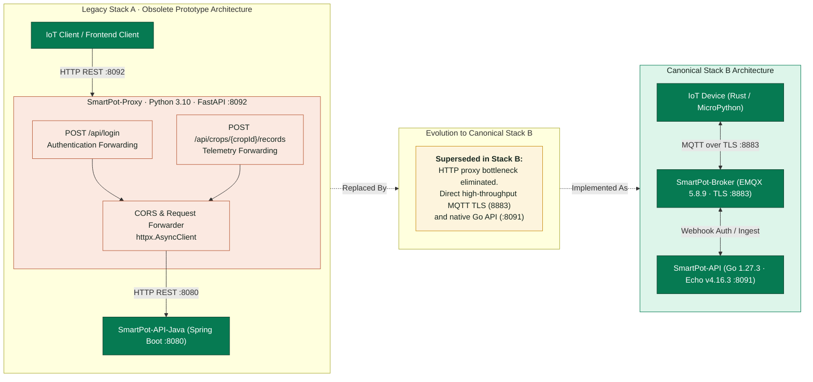

# SmartPot-Proxy (Legacy Architecture Reference)

> [!NOTE]
> **Legacy Stack A Architecture**: Deprecated and archived. Superseded in Canonical Stack B by direct MQTT TLS communication via [SmartPot-Broker](https://github.com/SmartPotTech/SmartPot-Broker) (EMQX 5.8.9) and [SmartPot-API](https://github.com/SmartPotTech/SmartPot-API) (Go 1.27.3 / Echo v4.16.3).

## Project Status

[](https://github.com/SmartPotTech/SmartPot-Proxy/actions/workflows/build-and-publish.yml)

## Description

SmartPot-Proxy was an early prototype reverse proxy built with Python 3.10 and FastAPI that forwarded HTTP telemetry from ESP32 microcontrollers to the backend before the adoption of the unified MQTT v1 architecture.



## Docker Image Build (Historical)

1. Build the Docker container image:

   ```bash
   docker build -t sebastian190030/proxy-smartpot:latest .
   ```

2. Publish to container registry:

   ```bash
   docker push sebastian190030/proxy-smartpot:latest
   ```
